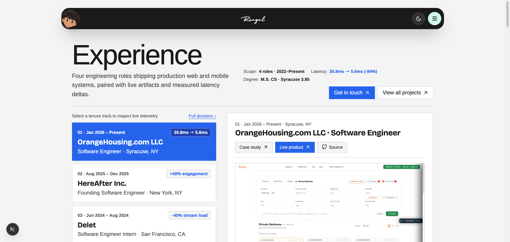
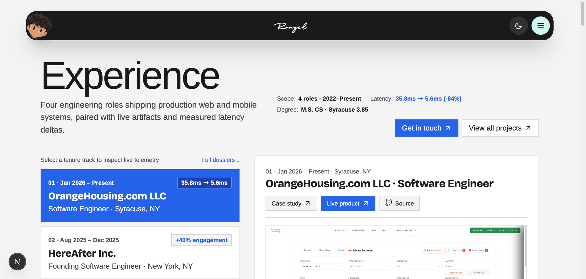
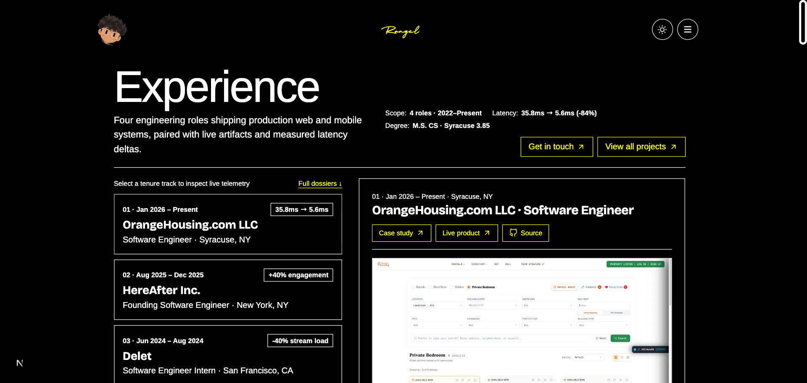
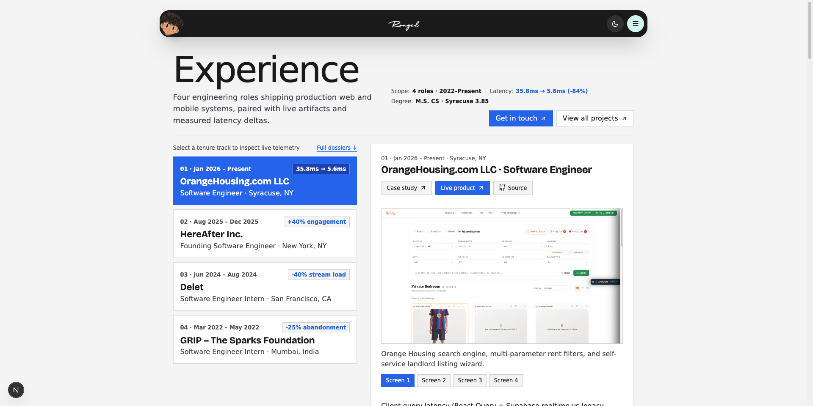
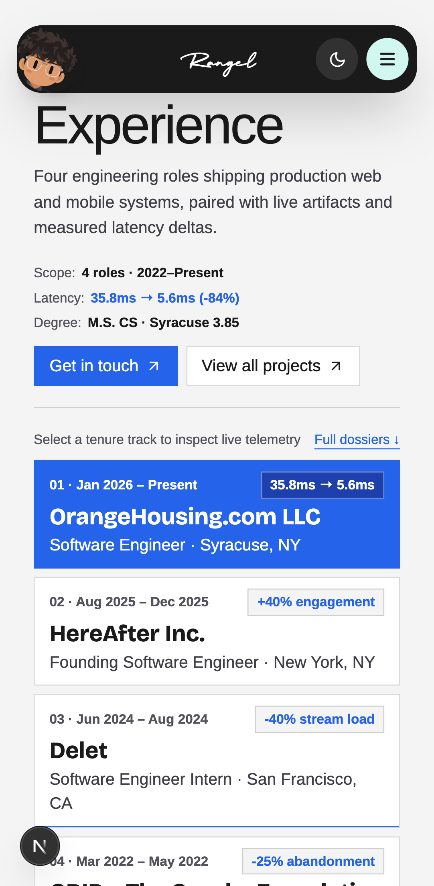
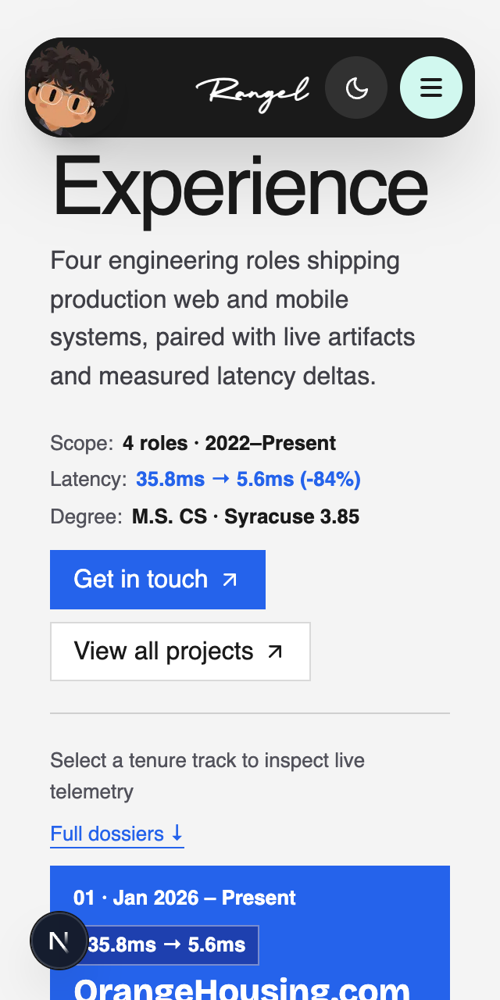
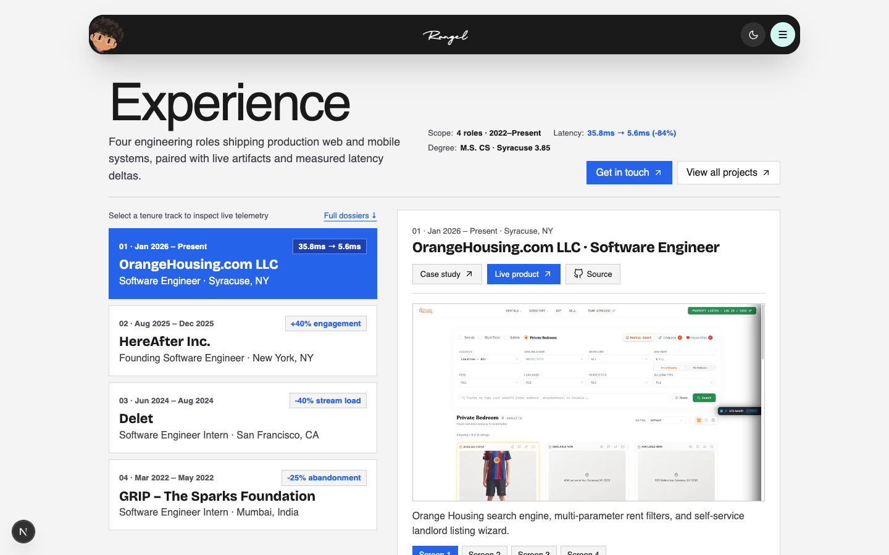
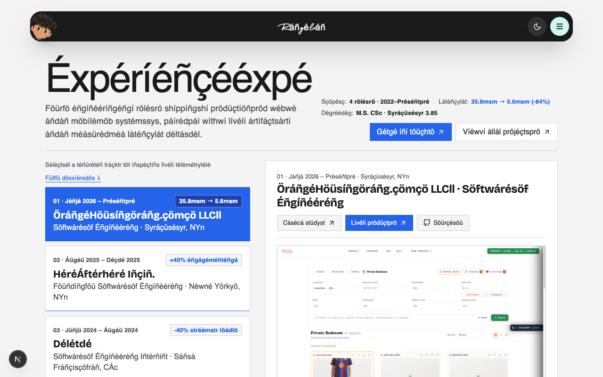
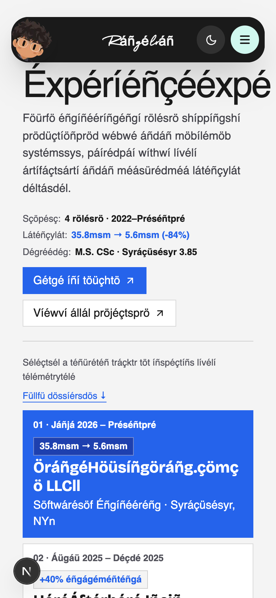

# Matrix: http://localhost:3001/experience

Host: mac (25.5.0). Fonts on other OSes are metric-compatible stand-ins.

## windows-125 · 1536×730 @1.25x · Google Chrome

- note: Text in system-font stacks renders as: Instrument Sans, sans-serif → Arial (e.g. "Experience")

## windows-150 · 1280×610 @1.5x · Google Chrome

- note: Text in system-font stacks renders as: Instrument Sans, sans-serif → Arial (e.g. "Experience")

## windows-hc · 1536×730 @1.25x · Google Chrome

- note: Text in system-font stacks renders as: Instrument Sans, sans-serif → Arial (e.g. "Experience")

## linux · 1920×960 @1x · Google Chrome

- note: Text in system-font stacks renders as: Instrument Sans, sans-serif → DejaVu Sans (e.g. "Experience")
- warn: 9 text blocks wrap onto more lines with linux fonts: "Client query latency (React " 1→2 lines; "Shipped systems & role dossi" 1→2 lines; "Primary benchmark" 1→2 lines; "+40% engagement" 1→2 lines

## android · 412×840 @2.625x · Google Chrome

- note: Text in system-font stacks renders as: Instrument Sans, sans-serif → Roboto (e.g. "Experience")

## firefox

Skipped: firefox is not installed. Optional: node "/Users/rangelkoli/.claude/skills/web-designer/scripts/doctor.mjs" --engines

## safari

Skipped: webkit is not installed. Optional: node "/Users/rangelkoli/.claude/skills/web-designer/scripts/doctor.mjs" --engines

## safari-iphone

Skipped: webkit is not installed. Optional: node "/Users/rangelkoli/.claude/skills/web-designer/scripts/doctor.mjs" --engines

## reflow-320 · 320×640 @2x · Google Chrome

## motion · 1440×900 @1x · Google Chrome

## l10n · 1280×800 @1x · Google Chrome

## l10n-phone · 390×844 @2x · Google Chrome

