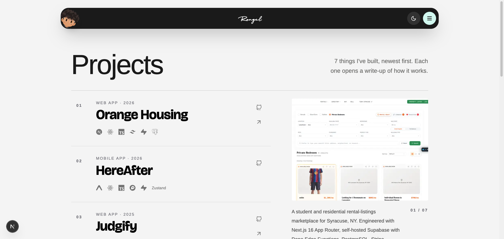
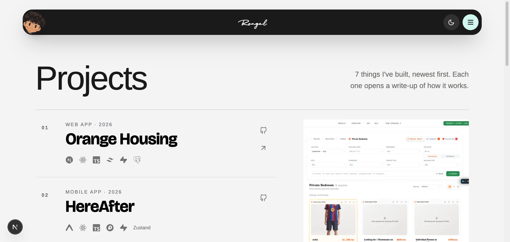
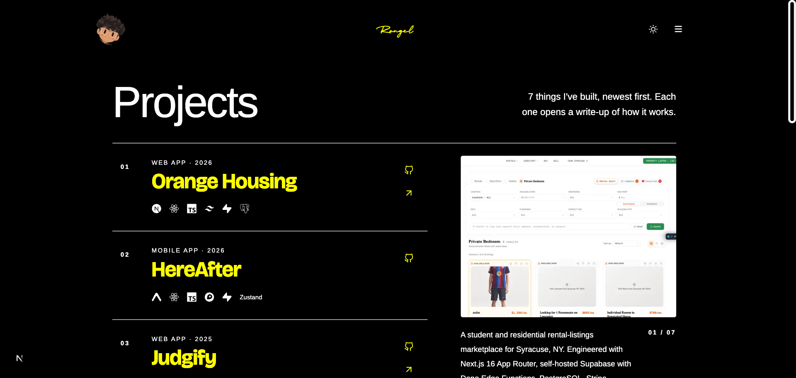
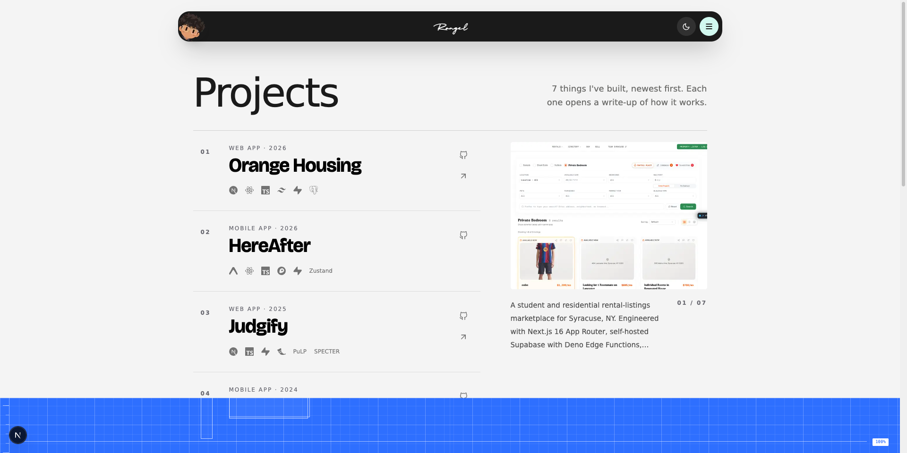
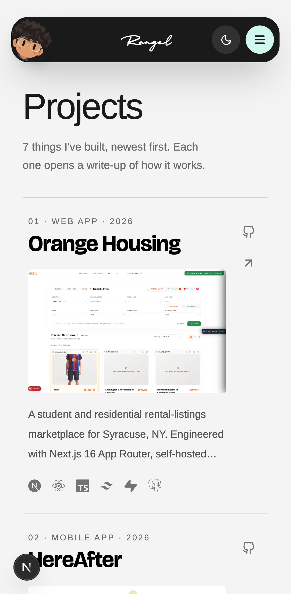
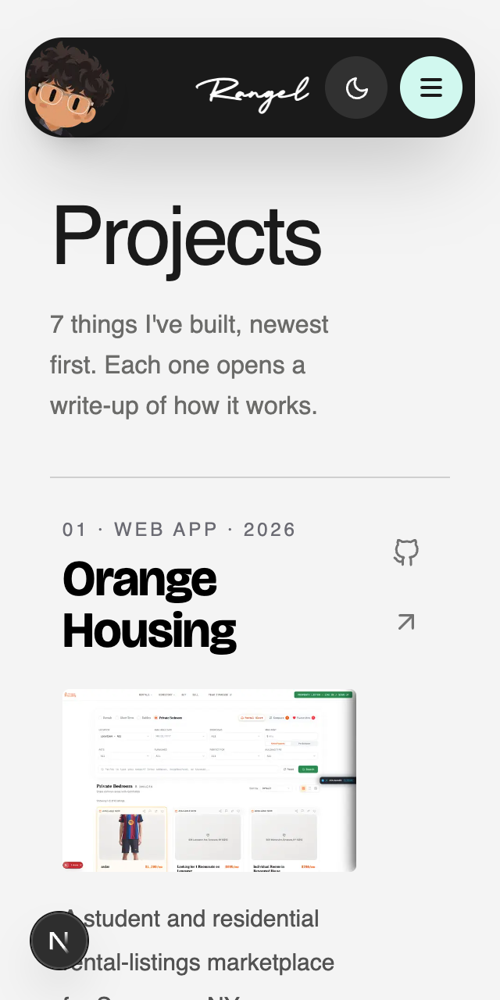
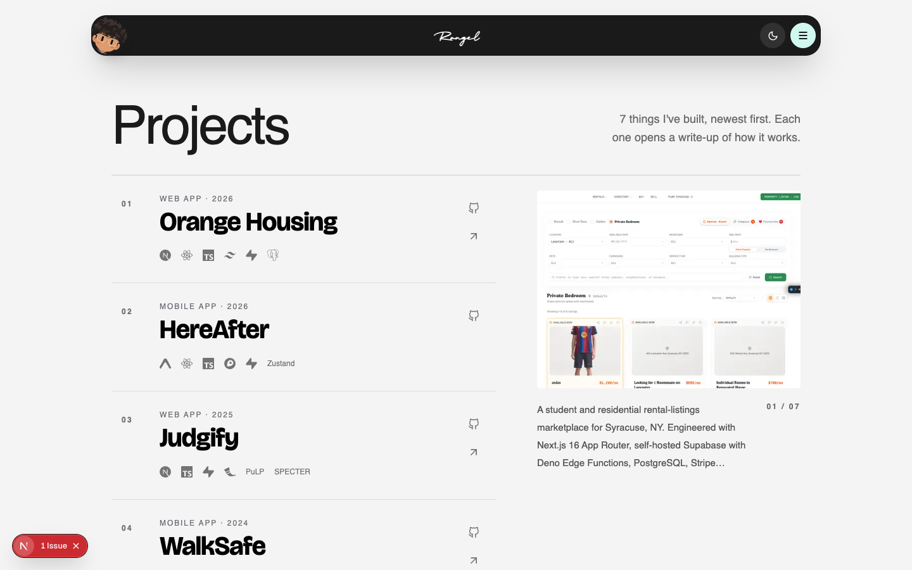
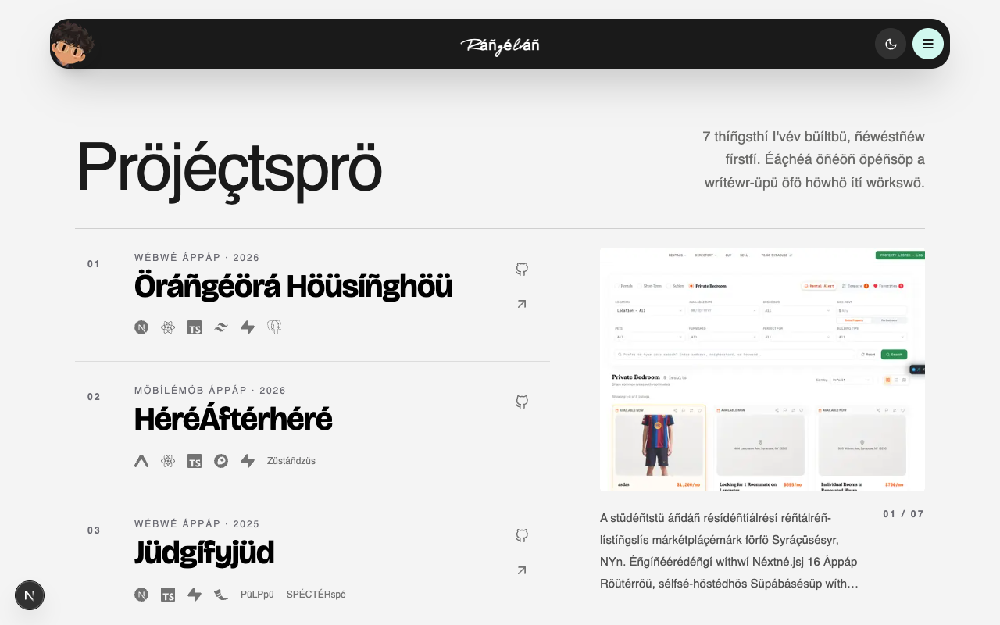
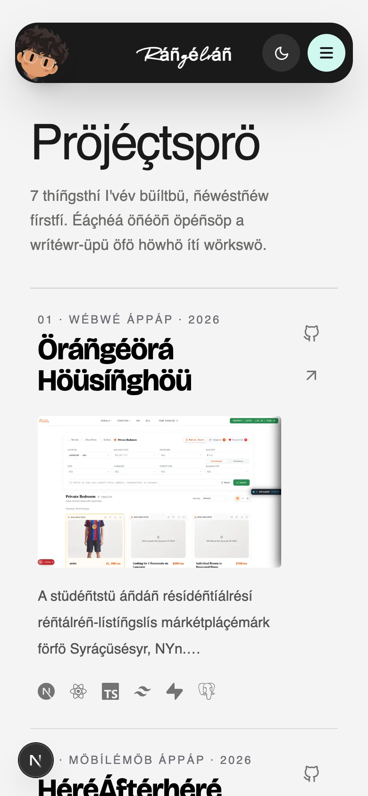

# Matrix: http://localhost:3001/projects

Host: mac (25.5.0). Fonts on other OSes are metric-compatible stand-ins.

## windows-125 · 1536×730 @1.25x · Google Chrome

- note: Text in system-font stacks renders as: Instrument Sans, sans-serif → Arial (e.g. "Projects")
- warn: No action in the first screen at 1536×730: the most common Windows laptop viewport is short. Bring the action up.

## windows-150 · 1280×610 @1.5x · Google Chrome

- note: Text in system-font stacks renders as: Instrument Sans, sans-serif → Arial (e.g. "Projects")
- warn: No action in the first screen at 1280×610: the most common Windows laptop viewport is short. Bring the action up.

## windows-hc · 1536×730 @1.25x · Google Chrome

- note: Text in system-font stacks renders as: Instrument Sans, sans-serif → Arial (e.g. "Projects")
- **FAIL** In High Contrast these controls lose their shape (backgrounds are removed; give them a border or outline, transparent is fine): "Switch to light them"; "Open menu"

## linux · 1920×960 @1x · Google Chrome

- note: Text in system-font stacks renders as: ui-monospace, SFMono-Regular, Menlo → DejaVu Sans Mono (e.g. "100 %"); Instrument Sans, sans-serif → DejaVu Sans (e.g. "Projects")
- warn: No action in the first screen at 1920×960: the most common Windows laptop viewport is short. Bring the action up.

## android · 412×840 @2.625x · Google Chrome

- note: Text in system-font stacks renders as: Instrument Sans, sans-serif → Roboto (e.g. "Projects")

## firefox

Skipped: firefox is not installed. Optional: node "/Users/rangelkoli/.claude/skills/web-designer/scripts/doctor.mjs" --engines

## safari

Skipped: webkit is not installed. Optional: node "/Users/rangelkoli/.claude/skills/web-designer/scripts/doctor.mjs" --engines

## safari-iphone

Skipped: webkit is not installed. Optional: node "/Users/rangelkoli/.claude/skills/web-designer/scripts/doctor.mjs" --engines

## reflow-320 · 320×640 @2x · Google Chrome

- **FAIL** Text clipped: "AgroBasket" cut by its container

## motion · 1440×900 @1x · Google Chrome

## l10n · 1280×800 @1x · Google Chrome

## l10n-phone · 390×844 @2x · Google Chrome

- **FAIL** Text clipped: "ÁgröBáskétágrö" cut by its container
